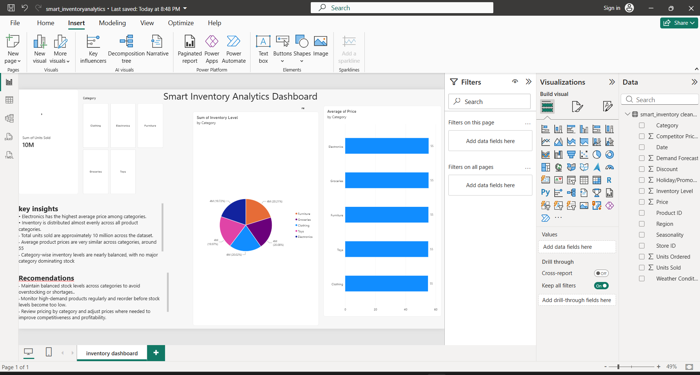

# Smart Inventory Analytics

A Data Analyst portfolio case study that follows retail inventory data from Excel preparation to MySQL analysis and a Power BI dashboard. The accompanying React website presents the methodology, verified findings, recommendations, and original project files.

## Objective

Explore patterns in stock levels, product categories, pricing, demand, and sales performance, and communicate the findings clearly enough for a recruiter to inspect the analysis and its evidence.

## Dataset and scope

**Source:** Retail Store Inventory Forecasting Dataset from Kaggle.

**Disclosure:** The dataset is synthetic but realistic, used for learning and portfolio analysis. It does not describe a real company. Recommendations are proposed next steps from a portfolio exercise, rather than demonstrated business outcomes.

The supplied cleaned CSV contains **73,100 records**, **15 fields**, and **5 categories**: Clothing, Electronics, Furniture, Groceries, and Toys. Fields include Date, Store ID, Product ID, Category, Region, Inventory Level, Units Sold, Units Ordered, Demand Forecast, Price, Discount, Weather Condition, Holiday/Promotion, Competitor Pricing, and Seasonality.

The price currency and discount unit are unspecified. Inventory totals sum repeated daily snapshots; they do not represent unique physical stock or a current stock balance. No revenue, profit, causal effects, forecast accuracy, or realized business improvements are claimed.

## Technologies

- Analysis: Microsoft Excel, MySQL, SQL, Power BI Desktop
- Portfolio: React 19, Vite 7, TypeScript, Tailwind CSS 4, Motion, Lucide React
- Typography: locally hosted Manrope via Fontsource
- Validation: TypeScript, Playwright, Node.js SHA-256 artifact verification
- Sharing: GitHub; prepared for Vercel static hosting

The website has no backend, authentication, environment variables, or browser-side CSV parsing.

## Data preparation

The original project notes describe inspecting the data in Excel, fixing the Date column display, enabling filters, checking for blanks and duplicate rows, and saving `cleaned_inventory.csv`. The original notes report no duplicates. This repository retains the supplied CSV exactly; the website implementation does not repeat or modify that cleaning process.

`scripts/generate-data.mjs` reads the cleaned CSV during development, checks row shapes and required numeric fields, and precomputes the small `src/data/metrics.json` object. Prices are accumulated in integer hundredths to avoid cumulative floating-point error. The browser receives the summary rather than the full CSV.

## SQL analysis

[View the full SQL analysis](public/inventory_analysis.sql).

The query collection expands the original three queries with named outputs and explicit MySQL column quoting:

- Record and category counts
- Records and average prices by parsed calendar date
- Average price by category
- Summed inventory observations by category
- Units sold by category and across the full dataset
- Average demand forecast and discount by category
- Top product IDs by recorded units sold
- Missing values in the fields used for the website summaries

Import the CSV into `smart_inventory.cleaned_inventory` in MySQL 8+, retaining the source column names. Import numeric fields as numeric types and Date as a DD-MM-YYYY string. Queries use `STR_TO_DATE` for chronological date grouping. If importing Date as a native DATE instead, adjust that conversion accordingly. The website includes six excerpts taken directly from the SQL file. The queries have not been executed against a live MySQL server in this implementation.

## Power BI dashboard

The supplied report visualizes category pricing, inventory distribution, and total units sold, with category filtering inside Power BI Desktop. The screenshot is an original Power BI Desktop capture, including the authoring interface, and is preserved without alteration.



[Download the Power BI report](public/smart_inventoryanalytics.pbix) and open it with **Power BI Desktop**. The website uses a responsive screenshot and an accessible enlargement dialog. Report interactions are available in the downloaded PBIX. Local data-source connections inside the supplied PBIX may need to be configured in Power BI Desktop.

## Verified findings

The following summaries are calculated from the supplied CSV and support the findings shown in the dashboard:

| Category | Average price* | Inventory share** |
| --- | ---: | ---: |
| Clothing | 54.89 | 20.02% |
| Electronics | 55.31 | 19.72% |
| Furniture | 55.18 | 20.21% |
| Groceries | 55.27 | 20.08% |
| Toys | 55.03 | 19.97% |

*Currency unspecified; category means rounded to two decimals. **Share of summed daily inventory observations, rounded to two decimals.

- Electronics has the highest average price among the five categories.
- Inventory observations are distributed fairly evenly across categories.
- Total recorded units sold are **9,975,582**, approximately **10 million**.
- Category average prices remain close, ranging from **54.89 to 55.31**.

Balanced category totals alone do not establish optimal inventory levels or rule out individual stockouts.

## Recommendations

- Maintain balanced stock levels to reduce shortages and excess inventory.
- Monitor high-demand products regularly and reorder before inventory becomes too low.
- Review category pricing to maintain competitiveness and profitability.
- Compare inventory levels with demand forecasts when planning future orders.

These are analytical recommendations to investigate, not measured operational results.

## Website

The single-page portfolio contains:

1. Sticky navigation and an editorial hero with a verified category-inventory chart
2. Project overview, source disclosure, and KPI cards
3. Original Power BI dashboard showcase with an accessible lightbox
4. Selectable SQL previews and links to the full analysis
5. Evidence-backed insight cards and business recommendations
6. An analyst workflow from Kaggle through a future Vercel deployment
7. Tools, skills, project downloads, and repository links

Motion includes staggered section reveals, count-up KPIs, chart entrance, card and button feedback, and a scroll-linked workflow line on desktop. Mobile uses a vertical workflow. `prefers-reduced-motion` disables animated entrances and smooth scrolling. Navigation and dialogs support keyboard use, visible focus, and Escape handling.

## Local development

Use Node.js **22.12+** (Node 24 is also supported) and npm.

```sh
npm install
npm run dev
```

On Windows PowerShell systems where script execution is restricted, use `npm.cmd` in place of `npm`.

```sh
npm run data:generate  # Regenerate the small summary and SQL previews
npm run verify:assets # Verify originals, metrics, and SQL preview consistency
npm run typecheck     # Strict TypeScript check
npm run build         # Verify assets, type-check, and build to dist/
npm run preview       # Serve the production build locally
```

Builds verify the CSV, PBIX, and dashboard against their original SHA-256 hashes in `scripts/artifact-manifest.json`. Git attributes disable line-ending conversion for the CSV and binary artifacts. Do not edit those originals or change the hash baseline to bypass a failed check.

No lint tool is configured; strict TypeScript checking is included in every build.

## Browser checks

```sh
npm run build
npm run test:browser
```

Playwright uses installed Google Chrome. If Chrome is not available, install it or change `channel: 'chrome'` in `playwright.config.ts` to a locally available browser. The suite starts the Vite production preview and checks widths of 375, 430, 768, 1024, and 1440 pixels, horizontal overflow, browser errors, dashboard loading, SQL controls, mobile navigation, lightbox keyboard behavior, reduced motion, and served file hashes. It also verifies the PBIX download event. Screenshots and failure traces are saved to the ignored `test-results/` directory.

## Project structure

```text
public/
  cleaned_inventory.csv
  dashboard.png
  inventory_analysis.sql
  smart_inventoryanalytics.pbix
  favicon.svg
src/
  components/               # Case-study sections and shared UI
  data/
    metrics.json            # Generated, verified summary and SQL excerpts
    project.ts              # Project links and formatting
  App.tsx
  main.tsx
  index.css
scripts/
  artifact-manifest.json
  generate-data.mjs
  verify-assets.mjs
tests/
  portfolio.spec.ts
index.html
package.json
package-lock.json
playwright.config.ts
tsconfig.json
vite.config.ts
```

## Vercel deployment

The application is prepared for deployment but **has not been deployed**.

Import the repository into Vercel with:

| Setting | Value |
| --- | --- |
| Framework preset | Vite |
| Install command | npm install |
| Build command | npm run build |
| Output directory | dist |
| Node.js | 22.x or 24.x |
| Environment variables | None |

All public artifacts are copied to the build root by Vite. The site uses section anchors and does not need SPA rewrites or server functions. After publishing, verify the hosted downloads and update any portfolio/resume links with the actual public URL. No live deployment URL is claimed here.

## Resources

- [Power BI report](public/smart_inventoryanalytics.pbix)
- [SQL analysis](public/inventory_analysis.sql)
- [Cleaned dataset](public/cleaned_inventory.csv)
- [Original dashboard screenshot](public/dashboard.png)
- [GitHub repository](https://github.com/Roastedpotato21/smart-inventory-analytics)
